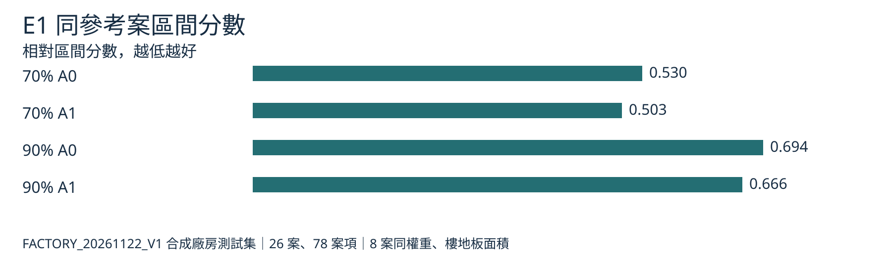
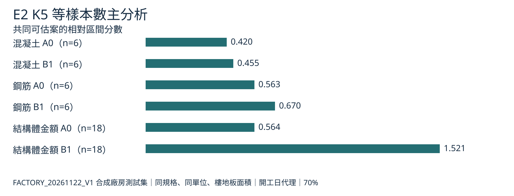
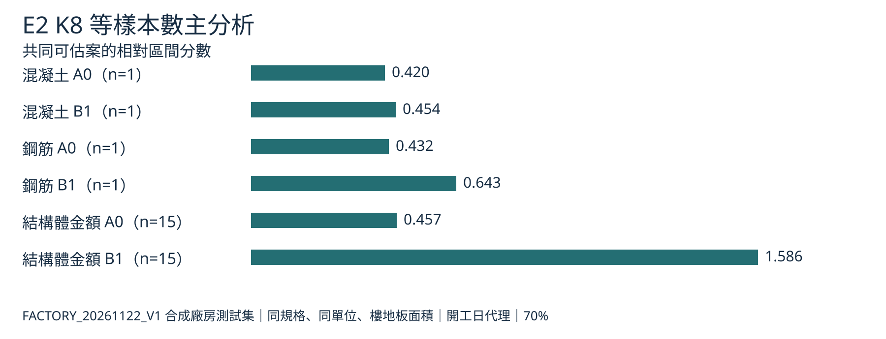
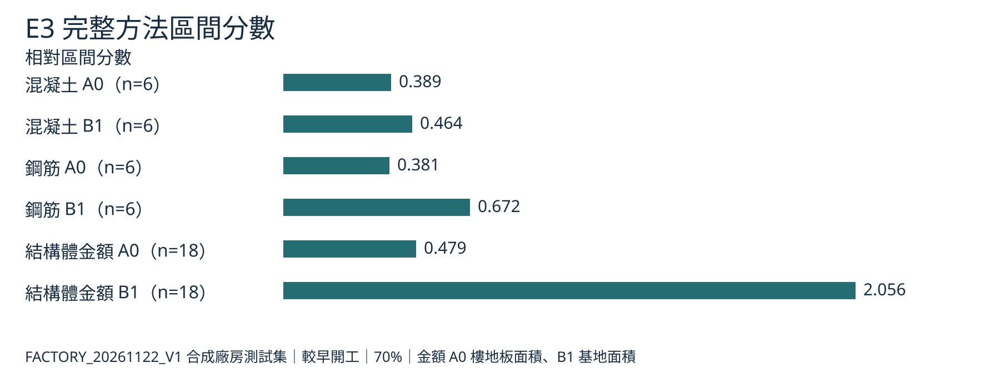
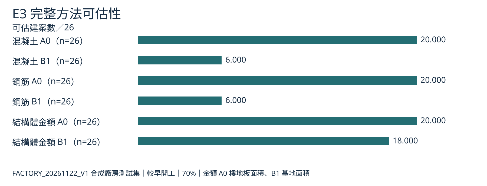
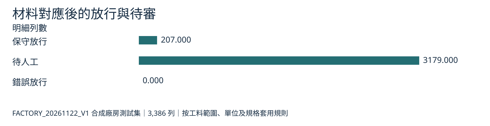
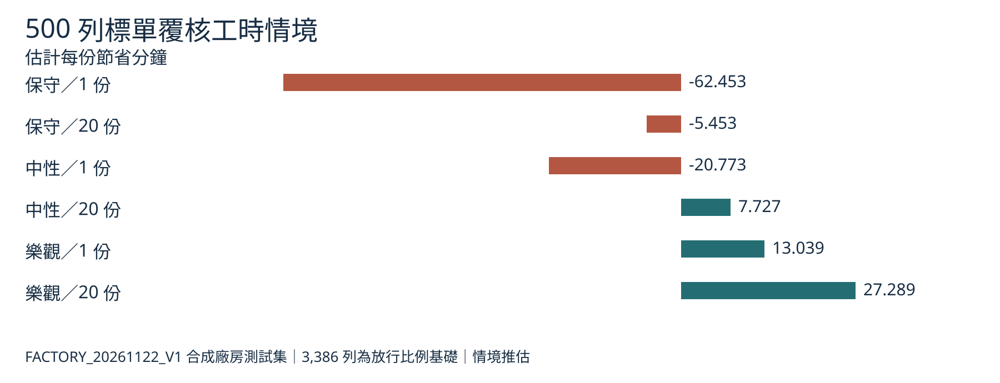
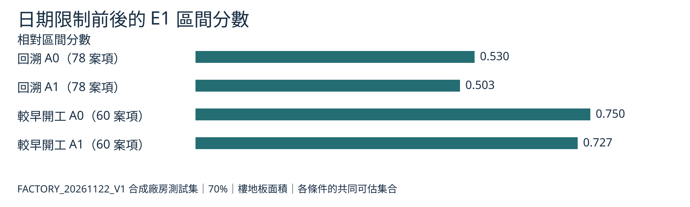

# 崴正營造 2A 十二項研究驗收報告

2026 年 11 月 23 日｜教授審查版｜研究隔離與合成重播

**研究判定：保留 A0。** A1 在廠房合成資料上有改善趨勢，70% 回溯分數改善 5.21%，但建案配對信賴區間跨零。限制只用較早開工參考案後，改善為 3.13%，低於預先固定的 5% 門檻。B1-K 比較的金額配對表現也無法支持採用。獨立工程盲測與真人工時仍缺。

## 資料和實驗口徑

廠房資料包 SHA-256 `b6d4d69188d7713ab8d86624e3f4eaa015ec4d1b51910ddf558d4ba7f53f4e4e`，原始 manifest SHA-256 `e04d7fa10e012825561031befff1f9d7f63b6e88272c9e528eb523fdcab6bfd0`。180 案各結構 60，分為 126 train、27 validation、27 test。診斷案 SC-0052 排除後，主測試 26 案。23,980 筆決標明細與歷史交易逐列對應。正式庫另外記錄住宅 210、廠房 126，兩批亦為合成來源。住宅 frozen CSV 與獨立真實盲測皆無可用適格包。現有開工日僅作可用日期的代理欄位。

A0 按現行相似案選擇與加權分位規格重播。E1 的 A0/A1 使用完全相同的參考案、權重及分母，A1 的 0.125 帶寬係數先由 validation 選擇，70% 為主要分析，90% 為敏感度。E2 固定兩法的 K（5 或 8），依各自選案方法保留候選差異。E3 保留完整方法各自的選案、分母及棄答。B1 依外部報告重建平均連結階層分群與群內等權 KDE，B2 將價格分母改為樓地板面積，數量仍以樓地板面積估算。分數越低越好。每次按結構整案重抽 2,000 次，種子 20261122，保留同案內工項的關聯性。

## 十二項實驗與證據

| 項目 | 原始整體狀態 | 目的、方法和證據 |
|---|---|---|
| T00 來源與切分 | PARTIAL | 9 個原始檔雜湊、180 案及 23,980 列配對通過。較早開工池 480 筆引用皆來自 train 且早於目標，回溯有 378／624 筆非較早。缺住宅快照與實際可用時點。 |
| T01 字典安全 | PARTIAL | 留出集 3,386 列，Contains 材料碼 3,386 正確，安全放行只有 207。156 筆同名異材即使有既有安全門檻仍錯放，需保留人工。缺跨廠商真值。 |
| T02 學習曲線 | PARTIAL | 同一切分重播 0／10／30／50／67／100／193 詞，67 詞為合成來源。原始測試集未見詞分母為零。需獨立住宅與廠房來源組。 |
| T03 工時與品質 | NOT RUN | 完成 167 列 × 2 合成配對練習、AB/BA 程序與分析器，0 名真人。100／500／1,000 列保守至樂觀結果屬假設情境。 |
| T04 單位及工料 | PARTIAL | EF 合法換算與無效係數拒絕通過。合成測試中有 156 筆異規格、156 筆錯單位，保守判定全部待人工。正式工料與核定規格待驗。 |
| T05 KDE 採用 | FAIL | 合成主比較完成。原預設採用門檻未通過，獨立住宅與真實工程外驗仍待。 |
| T06 異常邊界 | PARTIAL | 固定區間 720 筆合成觀察值擾動，480 筆端點／相鄰浮點判定符合規則。仍缺工程師核定正常與異常，Precision／Recall／FPR 留空。 |
| T07 Excel 回寫 | PARTIAL | Run #4 選表、入庫、Draft 及重複檔拒絕通過。Run #3 的 fixture 發布／重開／稽核通過。Run 45117656645 匯入後兩筆手動映射成功，其中一筆因合成主檔名稱不符白名單而未進歷史。修正 fixture 後重新驗證。 |
| T08 效能與穩定 | PARTIAL | 同一設備離線重播及 Run #4 兩種 HTTP 讀取有量測。建案 GET p50／p95 為 15.69／19.21 ms，兩列 2A Summary 為 28.33／34.28 ms，各 n=30。正式推論 HTTP 與大型匯入全流程仍待。 |
| T09 權限與證據 | PARTIAL | 隔離匿名 401、無效憑證 401、Reader 403、Supervisor 200，且有稽核讀回。正式部署的角色與權限仍待授權測試。 |
| T10 TF-IDF | PARTIAL | 材料候選僅給人工使用。合成未見別名 Top-1、Top-3 皆 78／156。同名異材 Top-1 0／156、Top-3 78／156。缺獨立真值與人工負擔。 |
| T11 階層分群 | PARTIAL | B1/B2 重建、等 K 及價格分母消融完成，外部報告數值探針通過。原作者完整實作和真實盲測未取得。 |

## 主要統計

| E1 樣本 | A0 分數 | A1 分數 | A1−A0 95% CI |
|---|---:|---:|---:|
| 回溯 70%（78 案項） | 0.5302 | 0.5026 | [−0.0706, +0.0135] |
| 回溯 90%（78 案項） | 0.6943 | 0.6664 | [−0.1111, +0.0354] |
| 較早開工 70%（60 案項） | 0.7501 | 0.7266 | [−0.1193, +0.0513] |
| 較早開工 90%（60 案項） | 1.1570 | 1.0006 | [−0.3338, +0.0101] |

回溯 70% 宏平均涵蓋率 A0 58.33%、A1 64.81%，相對寬度 0.3623、0.3881。兩法回溯中位數 MAPE 各 12.080%、12.084%。限制到較早開工案後，共同可估為 60／78，18 案項在此條件下未納入成對分數。完整方法 E3 的 70% 結構體金額共同可估 n=18，A0/B1 分數 0.479／2.056，覆蓋 55.6%／72.2%，寬度 0.368／1.366，P50 MAPE 12.9%／49.7%。B2 同條件分數 1.568，分母影響明顯。E2 金額 K5 B1−A0 +0.957（95% CI +0.264 至 +2.156，n=18）；K8 +1.129（+0.378 至 +2.425，n=15）。K8 兩數量項只有一件共同可估，各僅描述。

## 效能明細

同一 Windows 主機、Python 3.12、180 案 manifest，暖機一次後依輪次交替順序，使用獨立程序量三次。時間包括各腳本自己的讀取、執行與寫檔，RSS 為各程序最大工作集，不含隔離 HTTP 伺服器或 PostgreSQL。

| 離線流程 | p50 秒 | p95 秒 | 峰值 RSS KiB |
|---|---:|---:|---:|
| A0 | 0.298 | 0.301 | 58,932 |
| A1 含 A0 重播及 validation | 0.793 | 0.821 | 59,212 |
| B1/B2 含兩級區間與消融 | 11.914 | 11.999 | 25,964 |

n=3 時 nearest-rank p95 即觀測最大值。這些是實作流程成本，等 K 的同工作量測試另保留既有 A0-K/B1-K 證據。正式服務尚無研究 A1/B1 推論端點可供同路徑 HTTP 比較。

## 圖表

{width=88%}

{width=88%}

{width=88%}

{width=88%}

{width=88%}

{width=88%}

{width=88%}

{width=88%}

## 重現與交接

來源包解壓後，在 `research/2a_synthetic/kde_comparison` 執行下列命令，各輸出目錄需新建或為空。原始包保留在授權來源。已凍結比較程式、逐案 CSV 和圖形對應見 `fairness-v2/manifest.json`。

~~~
python replay_factory_dictionary.py <source> <new-dictionary>
python replay_factory_safety.py <source> <new-safety>
python factory_alias_stress.py <source> <safety>/aliases.csv
python factory_material_tfidf.py <source> <safety>
python replay_factory_b1.py <source> <new-retrospective>
python replay_factory_a1.py <source> <retrospective> .3
python replay_factory_a1.py <source> <retrospective> .1
python replay_factory_b1.py <source> <new-earlier> --past-only
python replay_factory_a1.py <source> <earlier> .3 --past-only
python replay_factory_a1.py <source> <earlier> .1 --past-only
python replay_factory_equal_n.py <source> <new-equal>
python factory_equal_n_bootstrap.py <equal>
python audit_frozen_factory.py <source> <retrospective>/factory_a0_a1_pairs.csv <earlier>/past_only_factory_a0_a1_pairs.csv <new-audit>
python benchmark_frozen_pipelines.py <source> <retrospective>/factory_b1_pairs.csv <new-benchmark>
python factory_diagnostics_perf.py <source> <existing-perf-directory> --scale
python prepare_human_practice.py <source> <new-practice>
python analyze_human_crossover.py input_templates/human_time_trials_TEMPLATE.csv <new-human-output>
~~~

原始隔離證據為 [Run 45115813539](https://github.com/YI-CHENLIN1204/BiddingSystem-2A/actions/runs/45115813539)（`cf6465ef21e65456765b182ee1d7d902715f10ac`），API 產物 14791179321 與 Word 產物 14791089656。研究分支起點為 `078f173df2f99e54e36e14aaf95ad2f4733423c2`，最新執行證據由同分支交接記錄連結。

## 結案所需外部輸入

提供住宅 frozen CSV 和 manifest、具授權的去識別住宅及廠房完整決標檔（含可用時點），以及盲態工程師核定的材料、規格與異常真值。真人 AB/BA 需配對標單及不同操作人員的場次紀錄。若要聲稱忠實重現原作者，需取得其原始碼和未公開參數。正式權限或效能若列作驗收，需核准的獨立部署副本。
